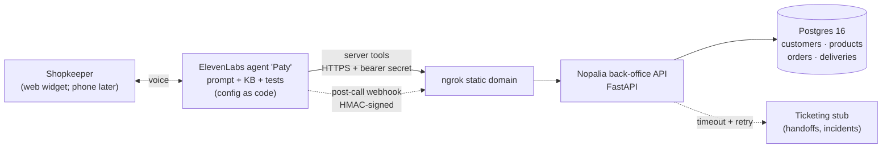

# Retailer Voice Agent: "Paty" for Productos Nopalia

A simulated end-to-end **Forward Deployed Engineering engagement**. It builds a Spanish (es-MX)
**ElevenLabs voice agent** that lets small retailers (tiendas de abarrotes) check order status,
reorder their usual products, and report delivery problems. The agent hands off to a human when
a request is out of scope.

> Productos Nopalia is a **fictional** consumer-goods company. All data is invented.
> Code and docs are in English. The agent speaks Mexican Spanish.

## Architecture



Solid lines exist today. Dotted lines arrive in M2/M3 (see the [project plan](docs/00-project-plan.md)).

## Status

| Milestone | |
|---|---|
| M0 Discovery & setup | ✅ |
| M1 Customer systems API (read side) | ✅ |
| M2 Integration hardening (auth, idempotency, webhooks, observability) | ⏳ |
| M3 Agent as code (ElevenLabs CLI) | ⏳ |
| M4 Automated agent tests | ⏳ |
| M5 Customer docs, demo recording | ⏳ |

## Quickstart

Prerequisites: Docker, [uv](https://docs.astral.sh/uv/) and `make`.

```bash
make up        # build + start Postgres and the API, run migrations
make seed      # load fictional demo data (dates relative to today)
open http://localhost:8000/docs
make check     # ruff + mypy + pytest (same as CI)
```

Try the tools the agent will call:

```bash
curl "localhost:8000/v1/customers/lookup?phone=81%205550%201234"
curl  localhost:8000/v1/customers/10234/orders/4721          # en ruta hoy
curl  localhost:8000/v1/customers/10234/usual-order          # "lo de siempre"
curl "localhost:8000/v1/products/search?q=sopa%20de%20vasito" # nickname → SKU
```

### Demo data

| Customer code | Store | Scenario folios |
|---|---|---|
| `10234` | Abarrotes Doña Lupe | `4721` en ruta hoy · `4715` entrega fallida ayer · `4730` en preparación |
| `20518` | Mini Súper El Güero | `5721` · `5715` · `5730` |
| `31007` | Tienda La Esperanza | `6721` · `6715` · `6730` |

## Tool API (current)

| Method & path | Purpose |
|---|---|
| `GET /v1/customers/lookup?customer_code=` or `?phone=` | Identify the calling store |
| `GET /v1/customers/{code}/orders` | Recent orders (newest first, max 10) |
| `GET /v1/customers/{code}/orders/{folio}` | Status, items, delivery window (scoped to the store) |
| `GET /v1/customers/{code}/usual-order` | Typical basket from the last 5 orders |
| `GET /v1/products/search?q=` | Fuzzy, accent-insensitive search incl. nicknames |

Design rationale: [ADR-0002](docs/adr/0002-tool-api-contract.md).

## Repository layout

```
api/            FastAPI service simulating Nopalia's back office (SQLAlchemy 2.0, Alembic)
agent/          ElevenLabs CLI project: agent, tools, tests (M3)
docs/           Discovery, design, runbook, exec summary, ADRs, lessons learned
infra/          Local infrastructure bits (Postgres init)
```

## Docs

- [Project plan & backlog](docs/00-project-plan.md)
- [Discovery call summary](docs/01-discovery-call.md)
- ADRs: [0001 local hosting via tunnel](docs/adr/0001-local-hosting-with-tunnel.md) ·
  [0002 tool API contract](docs/adr/0002-tool-api-contract.md)
