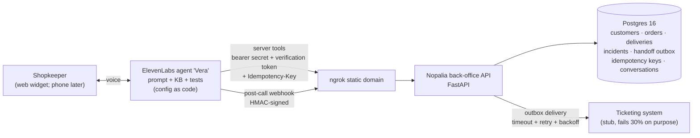

# Retailer Voice Agent: "Vera" for Productos Nopalia

A simulated end-to-end **Forward Deployed Engineering engagement**. It builds a Spanish (es-MX)
**ElevenLabs voice agent** that lets small retailers (tiendas de abarrotes) check order status,
reorder their usual products, and report delivery problems. The agent hands off to a human when
a request is out of scope.

> Productos Nopalia is a **fictional** consumer-goods company. All data is invented.
> Code and docs are in English. The agent speaks Mexican Spanish.

<!-- Demo GIF: record a call with docs/06-demo-script.md, save as docs/demo.gif, then replace
     this comment with:  -->
**Start here:** [executive summary](docs/04-executive-summary.md) ·
[solution design](docs/02-solution-design.md) · [demo script](docs/06-demo-script.md)

## Architecture



Run `make up`, `make tunnel` and `make agent-deploy`, then talk to Vera from the ElevenLabs dashboard. See [agent/README.md](agent/README.md).

## Status

| Milestone | |
|---|---|
| M0 Discovery & setup | ✅ |
| M1 Customer systems API (read side) | ✅ |
| M2 Integration hardening (auth, verification, idempotency, webhooks, observability) | ✅ |
| M3 Agent as code (ElevenLabs CLI + SDK) | ✅ |
| M4 Automated agent tests (11 defined, validated in CI; runs cost credits) | ✅ |
| M5 Customer docs | ✅ · demo recording ⏳ |

## Quickstart

Prerequisites: Docker, [uv](https://docs.astral.sh/uv/) and `make`.

```bash
make env       # create .env with random local secrets (git-ignored)
make up        # build + start Postgres, API, ticketing stub; run migrations
make seed      # load fictional demo data (dates relative to today)
open http://localhost:8000/docs
make check     # ruff + mypy + pytest (same as CI)
make latency   # send demo traffic, print p50/p95 per tool
```

Walk through a call the way the agent does:

```bash
set -a; . ./.env; set +a
H=(-H "Authorization: Bearer $NOPALIA_TOOL_API_TOKEN" -H "X-Conversation-Id: conv_demo_1" -H "Content-Type: application/json")

curl "${H[@]}" "localhost:8000/v1/customers/lookup?customer_code=10234"         # identify
curl "${H[@]}" -X POST localhost:8000/v1/customers/10234/verify -d '{"phone_last4":"1234"}'  # verify
V=(-H "X-Verification-Token: <token from verify>")
curl "${H[@]}" "${V[@]}" localhost:8000/v1/customers/10234/orders/4721            # en ruta hoy
curl "${H[@]}" "${V[@]}" -H "Idempotency-Key: conv_demo_1" -X POST \
  localhost:8000/v1/customers/10234/reorders \
  -d '{"items":[{"sku":"BOT-001","quantity":2}]}'                                 # run it twice: one order
```

### Demo data

| Customer code | Phone last 4 | Store | Scenario folios |
|---|---|---|---|
| `10234` | `1234` | Abarrotes Doña Lupe | `4721` en ruta hoy · `4715` entrega fallida ayer · `4730` en preparación |
| `20518` | `2518` | Mini Súper El Güero | `5721` · `5715` · `5730` |
| `31007` | `3107` | Tienda La Esperanza | `6721` · `6715` · `6730` |

## Tool API

All `/v1` routes need `Authorization: Bearer <tool token>`. Routes marked 🔐 also need an
`X-Verification-Token` for that store and conversation. Routes marked ♻️ need an `Idempotency-Key`.

| Method & path | Purpose |
|---|---|
| `GET /v1/customers/lookup?customer_code=` or `?phone=` | Identify the store (name + city only) |
| `POST /v1/customers/{code}/verify` | Verify caller (caller ID or phone last 4) → token |
| 🔐 `GET /v1/customers/{code}/orders` | Recent orders (newest first, max 10) |
| 🔐 `GET /v1/customers/{code}/orders/{folio}` | Status, items, delivery window |
| 🔐 `GET /v1/customers/{code}/usual-order` | Typical basket from the last 5 orders |
| `GET /v1/products/search?q=` | Fuzzy search incl. nicknames; flags ambiguous results |
| 🔐♻️ `POST /v1/customers/{code}/reorders` | Place order (credit check, zone cutoff) |
| 🔐♻️ `POST /v1/customers/{code}/incidents` | Report a delivery problem |
| ♻️ `POST /v1/handoffs` | Request a human callback (outbox → ticketing) |
| `POST /webhooks/elevenlabs` | Post-call webhook (HMAC-verified, deduplicated) |
| `GET /health/live`, `/health/ready` | Liveness / readiness |

Every error has the same shape: `{"code": "...", "message_es": "...", "fields": [...]}`.
`message_es` tells the agent what to say or do next.

## Repository layout

```
api/            FastAPI service simulating Nopalia's back office (SQLAlchemy 2.0, Alembic)
  src/nopalia_api/stubs/   Flaky ticketing system stand-in
agent/          ElevenLabs project: prompt, tools, KB, provisioning, simulations
docs/           Discovery, design, runbook, exec summary, ADRs, lessons learned
infra/          Local infrastructure bits (Postgres init)
scripts/        Latency report / traffic generator
```

## Docs

- [Project plan & backlog](docs/00-project-plan.md)
- [Discovery call summary](docs/01-discovery-call.md)
- [Solution design](docs/02-solution-design.md)
- [Runbook](docs/03-runbook.md)
- [Executive summary](docs/04-executive-summary.md)
- [Lessons learned](docs/05-lessons-learned.md)
- [Demo script & manual voice checklist](docs/06-demo-script.md)
- [Agent (Vera): setup, deploy, costs](agent/README.md)
- ADRs: [0001 local hosting via tunnel](docs/adr/0001-local-hosting-with-tunnel.md) ·
  [0002 tool API contract](docs/adr/0002-tool-api-contract.md) ·
  [0003 integration security](docs/adr/0003-integration-security.md) ·
  [0004 idempotency & outbox](docs/adr/0004-idempotency-and-outbox.md) ·
  [0005 agent config as code](docs/adr/0005-agent-config-as-code.md) ·
  [0006 environments & secrets](docs/adr/0006-environments-and-secrets.md)
