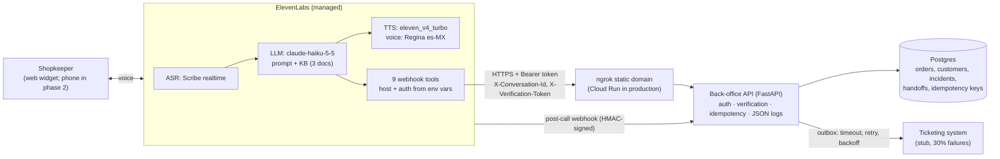
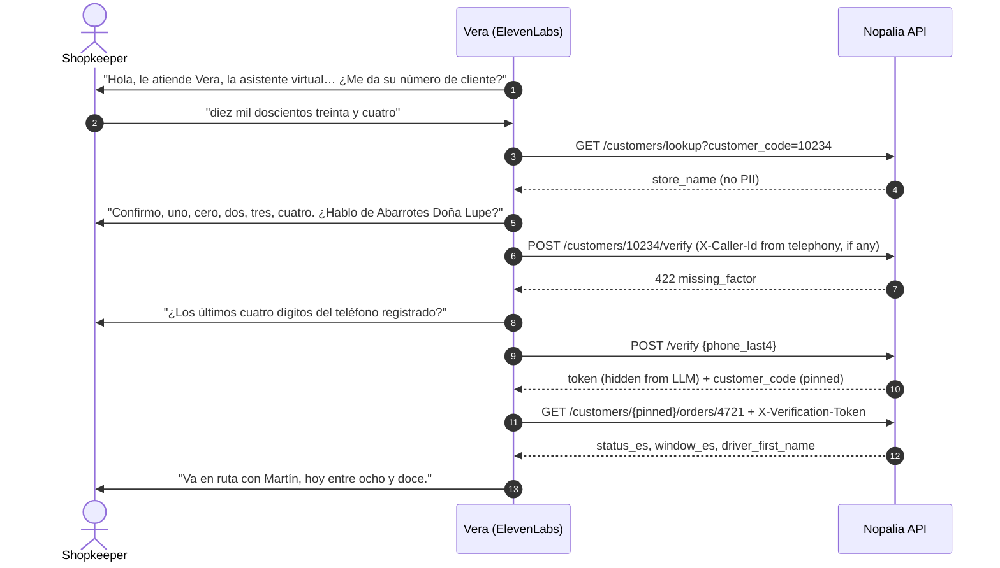

# Solution design: "Vera" voice agent for Productos Nopalia

> **Fictional.** Productos Nopalia, its people, figures and systems are invented for a
> portfolio exercise.

| | |
|---|---|
| **Status** | Pilot build complete (M0–M5); local deployment |
| **Audience** | Nopalia Engineering (Integrations), Customer Service, Credit |
| **Inputs** | [Discovery call](01-discovery-call.md), ADRs [0001](adr/0001-local-hosting-with-tunnel.md)–[0006](adr/0006-environments-and-secrets.md) |

## 1. Problem and scope

Nopalia's call center gets about 2,300 calls a week. At peak, callers wait 6–9 minutes and 18%
hang up. About 80% of calls fall into three repetitive intents. Vera, a Spanish (es-MX) voice
agent, takes those calls end to end and hands everything else to a person.

| Intent (share of calls) | Vera v1 | How |
|---|---|---|
| Order status (~45%) | ✅ resolves | `get_order` / `list_recent_orders`; status, window and driver in spoken Spanish |
| Reorder "lo de siempre" (~20%) | ✅ resolves | `get_usual_order` → read back → explicit "sí" → `create_reorder` (once, idempotent) |
| Delivery problem (~15%) | ✅ resolves | `report_incident` creates a ticket in the logistics queue |
| Credit, invoices, prices (~12%) | ↪ handoff | `request_handoff(reason=credit)`; Vera may only *say* the available credit |
| Other (~8%) | ↪ handoff | `request_handoff(reason=out_of_scope)` |
| FAQ: returns, delivery windows, credit terms | ✅ answers | Approved knowledge base text only; otherwise handoff |

Out of scope for v1: telephony (the pilot uses the web widget), outbound calls, payments and
credit changes, and onboarding new stores.

## 2. Architecture

**What runs where**
- **ElevenLabs** hosts speech recognition, the LLM, speech synthesis, turn-taking and tool
  orchestration. Everything there is deployed from `agent/` ([ADR-0005](adr/0005-agent-config-as-code.md)).
- **Nopalia's side** (`api/`) is a stand-in for the internal REST layer described in discovery.
  Nothing talks to the ERP directly. In the pilot it runs in Docker on a laptop behind a static
  ngrok domain ([ADR-0001](adr/0001-local-hosting-with-tunnel.md)).

## 3. Call flow

## 4. Tool API

All tools are `https://{{system__env_nopalia_api_host}}/v1/...`. Contract rules
([ADR-0002](adr/0002-tool-api-contract.md)):
- Small payloads. Every spoken value comes pre-rendered in a `*_es` field (dates, windows,
  references), because LLMs make mistakes with weekdays and padded numbers.
- Errors are `{code, message_es, fields}` and are passed through to the LLM
  (`tool_error_handling_mode: passthrough`), so Vera can repeat them.

| Tool | Route | Verified | Idempotent |
|---|---|:-:|:-:|
| `lookup_customer` | `GET /customers/lookup` | | |
| `verify_caller` | `POST /customers/{code}/verify` | | |
| `list_recent_orders` | `GET /customers/{code}/orders` | ✅ | |
| `get_order` | `GET /customers/{code}/orders/{folio}` | ✅ | |
| `get_usual_order` | `GET /customers/{code}/usual-order` | ✅ | |
| `search_products` | `GET /products/search` | | |
| `create_reorder` | `POST /customers/{code}/reorders` | ✅ | ✅ |
| `report_incident` | `POST /customers/{code}/incidents` | ✅ | ✅ |
| `request_handoff` | `POST /handoffs` | | ✅ |

A contract test (`api/tests/test_agent_contract.py`) checks every tool config against the
API's OpenAPI document and enums in CI. So a route or enum change on either side breaks the
build before anything is deployed.

## 5. Security and privacy ([ADR-0003](adr/0003-integration-security.md))

| Layer | Question it answers | Mechanism |
|---|---|---|
| Tool auth | Is this ElevenLabs calling? | Bearer token stored as a workspace secret behind an env var; constant-time compare; the API fails closed |
| Caller verification | Did *this caller* prove *this store*, *in this call*? | Caller ID or the phone's last 4 digits. HMAC token bound to store + conversation, 30 min TTL. Hidden from the LLM (`sanitize`). Store code pinned in a dynamic variable |
| Abuse | Can someone lock a store out? | Lockout is per conversation (3 failures). Store-level failures raise an alert instead of a lock |
| Webhook | Is this post-call event really from ElevenLabs? | HMAC signature, timestamp tolerance, rejects future timestamps, dedupe by `conversation_id` |

PII: the API returns first names only, never phone numbers. Transcripts are kept 30 days
(`retention_days`). The prompt forbids sharing another store's data, and a test checks that.

## 6. Reliability

- **No duplicate orders.** An `Idempotency-Key` (the conversation ID) is stored in the same
  transaction as the order. A retry replays the original response
  ([ADR-0004](adr/0004-idempotency-and-outbox.md)). Reorders lock the customer row for the
  credit check.
- **Handoffs survive a flaky ticketing system.** Each handoff is written to an outbox table first.
  Delivery uses timeouts, bounded retries and jittered backoff, and a sweep (`make retry-handoffs`)
  picks up the rest.
- **When tools fail,** Vera retries once, then offers a human. If even the handoff fails, she
  gives the call center number and does not claim anything was registered.

## 7. Performance

API-side p95, measured locally (`make latency`): **4–11 ms** for reads and **~71 ms** for
handoffs, against a 500 ms target. Those numbers leave out the tunnel and ElevenLabs. The
end-to-end voice latency of the pilot is still to be measured
([demo checklist](06-demo-script.md)).

## 8. Path to production (documented, not deployed)

| Pilot | Production |
|---|---|
| Docker Compose + ngrok | Cloud Run (the same image runs as non-root on `$PORT`) + Cloud SQL Postgres, private IP |
| Migrations at container start | Migrations as a separate release step (Cloud Run job) before traffic shifts |
| `make retry-handoffs` by hand | Cloud Scheduler → outbox sweep every 2 min, plus an alert on `failed` handoffs |
| `production` env var = ngrok host | `staging` / `production` values per env var ([ADR-0006](adr/0006-environments-and-secrets.md)) |
| Web widget | Mexican phone number via SIP trunk or Twilio; enables caller-ID verification |
| Ticketing stub | Nopalia's real ticketing API (same outbox contract) |

## 9. Known gaps

- **Holidays.** The delivery-date logic skips Sundays but not official holidays. The knowledge base
  mentions holidays, so the agent could promise a holiday delivery.
- **Clerks who don't know the phone digits.** Verification by phone digits fails for shop staff.
  A per-store PIN or caller ID is the fix (product decision for Nopalia CS).
- **One order per call.** Changing an order that's already placed goes to a human.
- **Interruptions and noise** can only be tested by voice ([checklist](06-demo-script.md)).
